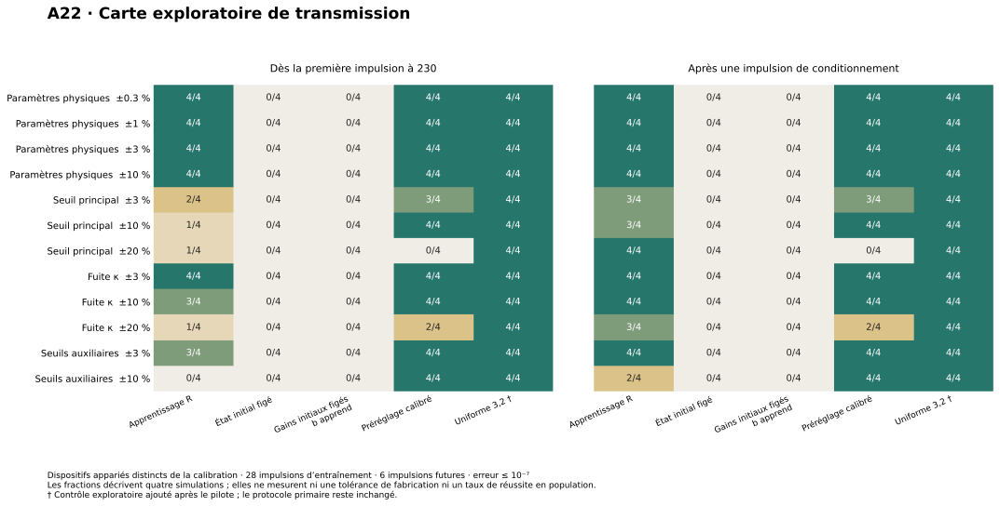

# A22 — apprentissage, préréglages et variations de seuils/fuite

Le pilote ne montre pas de supériorité de transmission de l'apprentissage sur un bon réglage fixe.
Il montre que les gains initiaux ne suffisent pas, que l'apprentissage construit une allocation
fonctionnelle, et qu'une allocation fixe transférée depuis deux autres dispositifs peut souvent
faire aussi bien. Un préréglage uniforme plus élevé réussit les 48 évaluations supplémentaires.

Ces nombres sont des observations numériques sur quatre dispositifs par condition. Ce ne sont
ni des garanties de boîte, ni des taux de réussite en population, ni des tolérances de fabrication.

## Méthode

Le protocole primaire et les graines ont été figés avant les essais dans `protocol.json`.
Chaque condition emploie deux dispositifs de calibration et quatre autres dispositifs d'évaluation,
avec une empreinte vérifiant l'appariement des paramètres et des états initiaux entre méthodes.
Les quatre tirages combinent deux dispositifs uniformes et deux tirages aux coins, avec des
politiques d'initialisation différentes. Les mêmes graines sont réutilisées aux dispersions
successives ; les conditions ne sont donc pas des cohortes indépendantes.

Les 28 impulsions d'entraînement sont suivies de six impulsions à partir de 230, avec les écarts
20,23,41,20,31. Réussir exige le bon nombre de réponses pour les 216 cellules et une erreur sur
chaque intervalle mesurable ≤ 1e-7. Le tableau distingue la première impulsion utile à 230 du
critère secondaire qui utilise cette impulsion comme conditionnement et commence les données à 250.

Les préréglages économiques sont choisis exclusivement sur la calibration : cinq gains uniformes,
un motif par rôle de port et deux allocations par cellule/port dérivées des gains appris sur les
dispositifs de calibration. La sélection favorise d'abord la réussite, puis les pertes/ajouts et
les cellules en échec, enfin le gain moyen. Aucun dispositif d'évaluation ne sert au choix du
préréglage. Les préréglages peuvent différer d'une condition à l'autre. Le taux de récupération
est fixé à 1.1 pour ces contrôles sans apprentissage.

Après le pilote, un contrôle supplémentaire applique le plus grand gain uniforme déjà présent
dans la grille, 3.2, à tous les dispositifs d'évaluation, sans retouche par dispositif ni par condition.
Il est explicitement postérieur au protocole primaire et ne remplace pas ses résultats.

## Carte de fonctionnement

Dans les colonnes avec une flèche : réussite dès 230 → réussite après conditionnement à 230.
Le maximum d'erreur porte sur l'apprentissage et sur le critère primaire, en unités de temps du
simulateur. Une réponse manquante n'est jamais transformée en erreur temporelle nulle.

| Famille | Apprentissage | Fixe calibré | Uniforme 3.2, après le pilote | Erreur max, apprentissage |
|---|---:|---:|---:|---:|
| Paramètres physiques ±0.3 % | 4/4 → 4/4 | 4/4 → 4/4 | 4/4 | 8.53e-14 |
| Paramètres physiques ±1 % | 4/4 → 4/4 | 4/4 → 4/4 | 4/4 | 8.53e-14 |
| Paramètres physiques ±3 % | 4/4 → 4/4 | 4/4 → 4/4 | 4/4 | 1.14e-13 |
| Paramètres physiques ±10 % | 4/4 → 4/4 | 4/4 → 4/4 | 4/4 | 8.53e-14 |
| Seuil principal ±3 % | 2/4 → 3/4 | 3/4 → 3/4 | 4/4 | 1.82e-06 |
| Seuil principal ±10 % | 1/4 → 3/4 | 4/4 → 4/4 | 4/4 | 0.000546 |
| Seuil principal ±20 % | 1/4 → 4/4 | 0/4 → 0/4 | 4/4 | 0.000493 |
| Fuite κ ±3 % | 4/4 → 4/4 | 4/4 → 4/4 | 4/4 | 1.14e-13 |
| Fuite κ ±10 % | 3/4 → 4/4 | 4/4 → 4/4 | 4/4 | 5.5e-06 |
| Fuite κ ±20 % | 1/4 → 3/4 | 2/4 → 2/4 | 4/4 | 0.0011 |
| Seuils auxiliaires ±3 % | 3/4 → 4/4 | 4/4 → 4/4 | 4/4 | 2.72e-05 |
| Seuils auxiliaires ±10 % | 0/4 → 2/4 | 4/4 → 4/4 | 4/4 | 0.698 |

Les gains initiaux figés échouent sur les quatre dispositifs de chacune des douze conditions,
que la récupération soit figée ou autorisée à apprendre. Ils perdent 4 584 réponses attendues
par condition, sans ajout : le réseau ne transmet pas depuis cette allocation initiale.

Avec apprentissage, aucune réponse supplémentaire n'est observée. Les échecs des variations du
seuil principal et de κ sont des erreurs sur les intervalles, sans impulsion perdue. À ±10 % sur
les seuils auxiliaires, deux réponses manquent sur les quatre dispositifs et l'erreur maximale
sur les intervalles mesurables atteint environ 0.698. Ces deux pertes ne se situent pas en couche 18.

Le contrôle uniforme 3.2 réussit 48/48 évaluations, avec zéro impulsion perdue ou supplémentaire et
une erreur maximale d'environ 1.42e-13. Ce résultat s'applique aux tirages testés et à ce protocole,
pas à tous les dispositifs des nouvelles familles.

## Gains et coût déclaré

Les moyennes portent sur les 540 ports d'entrée actifs du graphe, à la fin de l'entraînement,
puis sont moyennées sur les quatre dispositifs d'évaluation. Le maximum est aussi rapporté : une
petite moyenne peut cacher des ports proches de la butée.

| Boîte physique | Gain moyen appris | Gain moyen fixe calibré | Gain max appris | Gain max fixe calibré |
|---|---:|---:|---:|---:|
| ±0.3 % | 1.033742 | 1.034673 | 3.984499 | 3.984499 |
| ±1 % | 1.033669 | 1.036724 | 3.984499 | 3.984419 |
| ±3 % | 1.069078 | 1.043524 | 3.984499 | 3.984419 |
| ±10 % | 1.074292 | 1.185479 | 3.984499 | 3.984419 |

À ±0.3 %, les gains moyens sont presque identiques : 1.033742 contre 1.034673.
À ±3 %, le fixe calibré emploie même un gain moyen inférieur. À ±10 %, l'apprentissage emploie
un gain moyen inférieur à ce préréglage transféré, mais cela n'établit pas un optimum ou un
avantage sur toutes les allocations fixes. Le contrôle uniforme a un gain moyen et maximal de 3.2.

Le travail futur moyen à ±0.3 % vaut environ 12 750.86 pour R, 9 396.06 pour le fixe calibré et
9 307.64 pour l'uniforme 3.2. Il s'agit du coût déclaré par le simulateur, pas de joules mesurés.
Le contrôle fixe bénéficie notamment d'une récupération déjà réglée à 1.1 : ce contraste ne permet
pas d'isoler le coût causal de l'apprentissage. Un faible gain moyen n'implique pas ici un faible
travail. Le gain matériel lui-même n'a pas de coût de fabrication dans ces équations.

## Définition et contrôle des nouvelles familles

Le seuil principal modifie uniquement la garde de déclenchement. Le reset reste q=1 et l'impulsion
émise conserve sa forme canonique et sa durée 1. On n'a pas testé une variation de l'amplitude ou
de la durée des impulsions. κ varie par cellule et est partagé par la principale et ses trois
auxiliaires en mode READY. Les seuils auxiliaires font varier indépendamment les trois charges de
transition par port ; les doses complètes deviennent (seuil de feu - fin MARK)/2 et
8*(début ERROR - .025). Les facteurs d'actuation et le repos ne changent pas.

Le fond de variabilité des cinq paramètres physiques reste ±0.3 % dans ces nouveaux balayages.
Les fonctions de flot et de reset sont conservées, avec ces coefficients/gardes explicitement
paramétrés. La preuve actuelle ne couvre pas ces extensions.

Pour les dispositifs où l'apprentissage échoue, la recherche diagnostique reprend le même tirage
à demi-dispersion et sans perturbation ajoutée. Les 17 reprises à perturbation ajoutée nulle
réussissent ; certaines reprises à demi-dispersion échouent encore. Cette recherche est postérieure
aux échecs, et ne définit pas une frontière uniforme ni monotone de fonctionnement.

Les sept tests numériques passent : conservation d'un résultat du simulateur original, comparaison
avec intégration ODE, doses MARK/ERROR avec seuils variables, refus des seuils incohérents,
appariement et traitement des intervalles manquants. Les 24 contre-vérifications ODE locales
passent ; l'écart maximal sur les dates est 2.96e-11. Elles utilisent les entrées enregistrées du
réseau rapide : ce n'est pas une deuxième simulation indépendante de tout le réseau.

Une majoration conservatrice du travail instantané reste sous 223.93 pour les dispositifs du
pilote primaire et ses diagnostics, donc sous 500. Sous la loi énergétique déclarée, les portes
restent ouvertes pour E initial dans [50,100]. Le simulateur ne remplace pas une preuve de boîte.

## Réexamen de l'audit à ±0.3 %

La version examinée est `068d0abd96b48903d665658ad4259d787cce8481` (PR #3).
Le dossier publié obtient 4 PASS, 0 FAIL. La copie dont les gains des ports 0 et 2 de la cellule
(18,8) sont permutés obtient désormais 1 PASS, 3 FAIL. Le conflit d'ε est rejeté. Les 160 tests
principaux passent, ainsi que les 13 fichiers de tests du noyau exécutés séparément ici.
Cinq suites du pilote historique restent explicitement non bloquantes dans la CI.

La release `eps3e-3-campaign`, annoncée par la documentation, n'est toujours pas visible dans les
releases accessibles lors de ce réexamen. La reproduction complète de l'apprentissage à partir
des archives reste donc à terminer. Les résultats présents ne ferment pas cette réserve.

## Ce que ce pilote établit, et la suite utile

Il établit des exemples appariés où l'apprentissage construit une transmission absente au départ.
Il n'établit pas un avantage global sur un réglage fixe : la copie calibrée réussit souvent aussi
bien et l'uniforme 3.2 réussit tous les tirages testés. Les nouveaux seuils/fuites exposent surtout
la fidélité temporelle et l'entrée dans le régime utile dès la première impulsion.

La suite serait un échantillon plus grand, avec des allocations fixes choisies sur davantage de
calibration, un front de compromis fiabilité/gain moyen/gain maximal/travail, et des expériences
séparant les seuils auxiliaires un par un. Il faut également distinguer les 28 impulsions initiales
du protocole où une 29e impulsion conditionne les données, puis chercher les contre-exemples aux
meilleurs préréglages et à R. Modifier le vérificateur n'est pas nécessaire pour ces études.

## Données et reproduction

Le pilote contient 442 simulations de réseau (calibration, évaluation et diagnostics), auxquelles
s'ajoutent 48 simulations supplémentaires uniformes, soit 490 exécutions. Les graines, versions,
empreintes du code, dispositifs, dates d'impulsions et états terminaux sont conservés dans le
dossier de résultats remis avec cette étude. `README.md` donne les commandes de reproduction.
L'intégralité des données et des scores, y compris les échecs, a été conservée.
